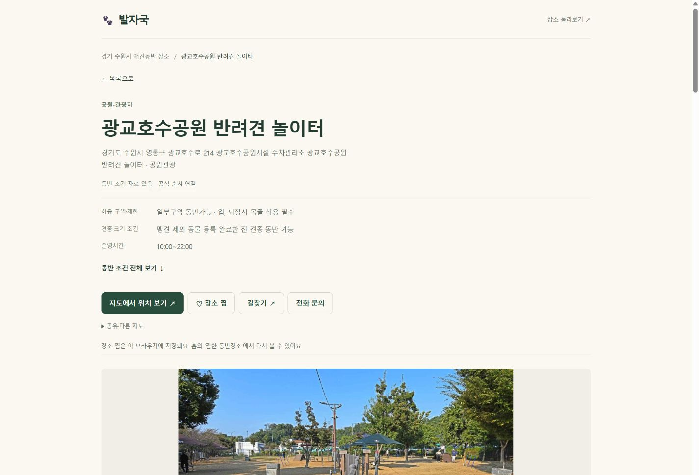
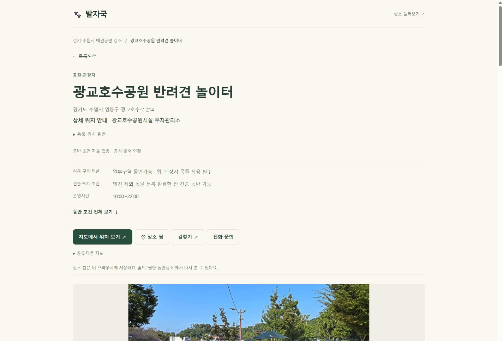
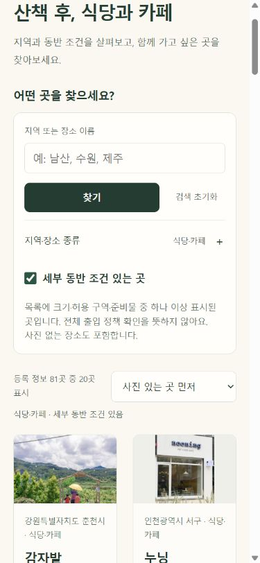
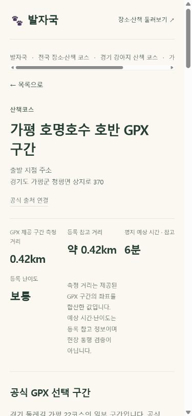

# 10차 품질·신뢰성·사용자 경험 개선

2026-10-27 / 로컬 검증 완료, 배포 확인 진행. 기준9차 ecf3d0d7a8. 중간 자동 날씨6627888653·3fafedab9a 보존.9차 Application40360729971/Pages40360730510 success부터 확인했다.

## 실제 문제와 수정
- 상세 주소에 도로명·시설명·분류가 붙어 있던 광교호수공원 놀이터 등 확인. 도로명+건물번호가 명확할 때만 분리하고, 상세 위치/정확한 원문을 별도로 제공. 애매한 지번·마스킹 주소는 추측하지 않음. 공통 표시4,614/상세위치 분리929/원문펼침4,208페이지. 전문업소는 이미 분리된 등록 주소 항목 보존.
- 기존 GPX 거리 레이블이 등록 거리 값을 GPX 측정값처럼 표시할 수 있었다. 이제 실제 제공된 GPX 좌표를 합산한 거리와 등록 참고 거리/시간/난이도를 분리. 단절된 parts 사이는 합산 연결하지 않음.55개의 출처 바인딩 GPX와30제안·327등록위치 안내 구분. 출입/현장 검증이라고 하지 않는다.412코스 전수 검사.
- 기본 사진 우선은 이미 유용해 유지. 사진이 없어도 포함하며 목록에 명시적 세부 동반 조건(견종/크기·구역·준비물)이 있는 곳을 찾는 선택 필터와 정렬 추가. 미확인/문의/일반 동반 가능 소개/운영시간만으로 세부조건을 확정하지 않음. 필터는 목록 요약 기준이며 현재 전체 정책 검증을 뜻하지 않는다. 카페 필터 표본81/1,713. 기본 검색 범위에서는 제외 없음.
- 코스/편의시설 선택 시 장소 조건 필터·정렬을 비활성화하고 불필요한 선택을 초기화. 기존 사진/등록/이름 정렬 및 URL·검색 상태 보존. 모바일 체크박스 입력창 스타일 충돌을 고쳐18px 입력/44px 라벨 터치 영역 확보.

## 방문·전환 통계
- 새 수집기/이벤트/원시IP/식별 항목 추가 없음. 기존 개인정보처리방침의 접속 분석 목적·선택 중단 기능과 기존 데이터만 사용.
- 기존 관리자 조회함수의 반환JSON에 검색 제출수/검색 브라우저 비율/분류 가능한 상세 조회 비중/페이지 평균 활동시간·활동 조회를 추가.1/7/30/90일 기존 기간 선택과 이전 조회 비교 유지. 숫자형이 아닌 실제 코스 ID도 현재 등록ID로 구분하며 목록 URL은 상세로 세지 않음.
- 테이블·정책·실행 권한·함수 입력/반환 타입/인증 및 SECURITY INVOKER 유지. 기존 제외판정은 행당1회 재사용. 기존 조회/일별/유입/캠페인 동일 비교 통과. [database-verification.json](database-verification.json).
- 지도/길찾기 구분 클릭률, 가입 버튼→실제 가입 완료, 정확한 이탈 단계는 미집계. 일반 링크 클릭으로 대체하지 않는다. 활동 미수집 기록은0으로 만들지 않고 미집계. browser·활동은 사람 인증이 아님. 검색 집계 연결이 보완되기 전 일부 누락 가능성을 표시.
- 관리자 화면은 로컬 테스트 데이터 fixture로 표시를 검증했으며 실로그인 운영 통계를 브라우저에서 확인한 것은 아니다.

## 검색 성능
9차 인덱스4,619건/manifest/불변JSON 바이트 동일, 분할 로더·중복 다운로드 방지·오류/재시도 유지. 새로운 성능 구조 변경은 하지 않았다.

Windows Chromium390×844, JSON 전송만 gzip+150ms+128,000B/s로 모사, 각3회 중앙값. 첫 결과 DOM 삽입까지이며 실제 휴대폰/중급CPU/paint 측정 아님.

|검색|9차|10차|
|---|---:|---:|
|전국 인덱스(서울 검색어)|3,310ms|3,303ms|
|캠핑 범주|868ms|859ms|
|식당·카페 범주|1,191ms|1,189ms|

차이는 작아 속도 향상으로 주장하지 않음. 카테고리 분할의 이점은 유지. [측정 요약](performance-summary.json), [18개 표본](search-performance.json).

## 범위·검증·제한
- 전체23,441페이지 생성, 상세22,317/목록1,114 공통 템플릿 검사. 원문107,561항목·사진5,639참조·메타/JSON-LD·기존URL·홈 구조 대조 오류0. 전체 동작의 실기기 검증을 뜻하지 않음. [원문 대조](source-preservation.json), [유형별 수](coverage.json).
- 전체307개 검사(추적306/기존 미추적offline-shell1). [tests-final.txt](tests-final.txt), [build-final.txt](build-final.txt).
- 대표13종×7폭(360/375/390/430/768/1024/1440)=91: 가로 넘침/짧은 주요CTA0. 관리자 테스트 데이터 화면 포함. [preview-final.json](preview-final.json).
- 별도 루트 글자 크기200%·가로 화면4건은 로컬 fixture 모사이며 실제OS/브라우저 핀치 확대가 아님. [text-scale.json](text-scale.json).
- 필터+조건정렬+40개→고양이역카페 상세→찜 선택/해제→방문준비→목록: URL/필터/정렬/40개/스크롤7688.6665px 복원. [return-flow.json](return-flow.json). 갤러리1/4→2/4→1/4. GPX지도 S/E·선 표시.
- 실제 iPhoneSafari/GalaxyChrome·중급CPU·실GPS·회원 서버동기화·외부지도앱/전화·네이티브공유·물리스와이프·핀치확대는 미검증. 지도·GPS·로그인·포인트 원래 로직은 변경하지 않음.
- 운영 배포 및 운영 표본 검증은 다음 단계. 관련 커밋/CI/최종 운영 자료를 완료 시 추가한다.

## 화면 비교

관리자 화면 이미지는 실제 통계가 아닌 테스트 데이터입니다: [모바일](admin-fixture-mobile.png) · [PC](admin-fixture-pc.png).
