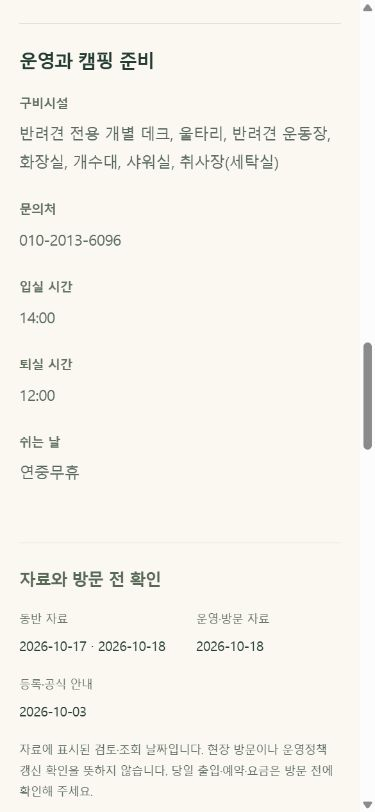
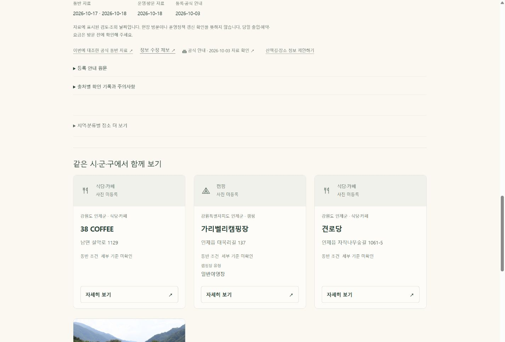

# 8차 품질 개선 — A 검증 완료, B 진행 예정

기준 main 3353855770. 2026-10-26.

## A 구현·검증
- 명시된 시설 구분자만 목록으로 가공. 원문과 추출 구간은 보존하고 불확실한 문장은 그대로 둔다.
- 상세 상단에 주요 동반 수칙과 확인된 운영시간을 배치. 장문 조건의 전체 보기 연결을 보존한다.
- 공원·숙소·캠핑·산책 사진의 기존 공통 참고 문구를 유형에 맞게 구분. 반복 촬영 안내 170개 갤러리 통합. 제공자·라이선스·날짜·원문은 유지.
- 공통 생성기 적용: 상세 22,317 / 목록 1,114. 이전 버전 원문 대조 107,561 항목, 사진 참조 5,639개 누락 0. 메타·JSON-LD·홈 구조 보존.
- 로컬 전체 283/283 통과(기존 미추적 offline-shell 1 포함). 대표 12화면×7폭 84개 가로 넘침·짧은 CTA 0. 전수 자동 검사와 대표 화면 검증은 별도 범위다.
- 수정: place-presentation.js, card-media.js, scripts/detail-editorial.mjs, scripts/place-card.mjs, detail-editorial.css, 버전 발행기·생성 페이지·관련 검사.

## 다음 B
/discover.html의 동일 전체 검색 데이터를 정적 JSON으로 분리하고 검색 의도 시 로딩. 오류·재시도·중복 요청·검색 누락·목록 복귀·성능을 실제 브라우저에서 검증한 뒤 별도 커밋.

실기기 GPS, 네이티브 전화 발신·공유 전송, 회원 서버 동기화는 이번 표시 변경의 검증 대상에서 제외. DB/Auth/GPS/지도 로직·관리자·홈 디자인·원천 자료를 변경하지 않았다.
