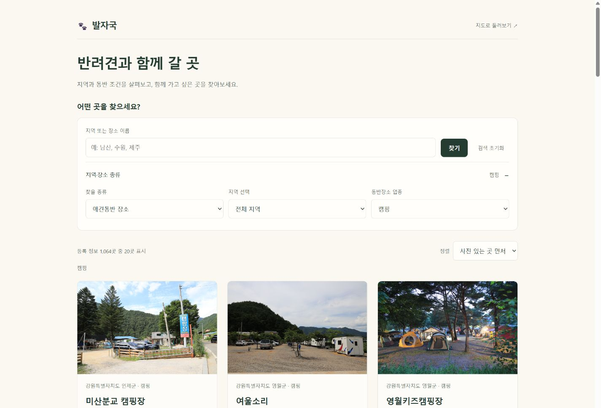
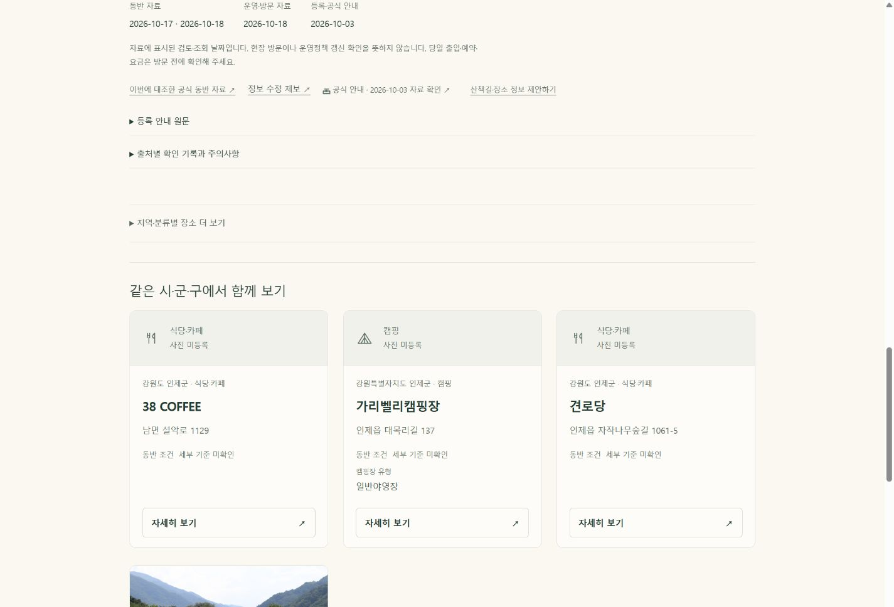

# 8차 품질 개선 — 완료·배포 확인

기준 main 3353855770. 2026-10-26.

## A 구현·검증
- 명시된 시설 구분자만 목록으로 가공. 원문과 추출 구간은 보존하고 불확실한 문장은 그대로 둔다.
- 상세 상단에 주요 동반 수칙과 확인된 운영시간을 배치. 장문 조건의 전체 보기 연결을 보존한다.
- 공원·숙소·캠핑·산책 사진의 기존 공통 참고 문구를 유형에 맞게 구분. 반복 촬영 안내 170개 갤러리 통합. 제공자·라이선스·날짜·원문은 유지.
- 공통 생성기 적용: 상세 22,317 / 목록 1,114. 이전 버전 원문 대조 107,561 항목, 사진 참조 5,639개 누락 0. 메타·JSON-LD·홈 구조 보존.
- 로컬 전체 283/283 통과(기존 미추적 offline-shell 1 포함). 대표 12화면×7폭 84개 가로 넘침·짧은 CTA 0. 전수 자동 검사와 대표 화면 검증은 별도 범위다.
- 수정: place-presentation.js, card-media.js, scripts/detail-editorial.mjs, scripts/place-card.mjs, detail-editorial.css, 버전 발행기·생성 페이지·관련 검사.

## B 구현·검증
- discover의 4,619개 검색 데이터를 동일한 JSON으로 분리. 이름/조건/사진/권리/원문 필드 전체 정확히 일치, 48개 검색 상태 결과 일치. 기본 화면은 요청하지 않으며 실제 검색 때 한 번 공유 요청한다.
- manifest의 SHA 버전과 건수 검증, 15초 제한, 실패 재시도, 마지막 필터 반영, 초기화 이후 늦은 응답 무시. 잘못된 데이터는 누락된 결과로 표시하지 않고 재시도를 안내한다.
- 목록 복귀 시 필터/정렬/표시 개수 유지. 비동기 결과 복원 후 뒤로가기 스크롤 복원, 사용자의 새 조작 우선. history.state 보존.
- 변경: place-search.js, scripts/generate-seo.mjs, scripts/publish-control-polish.mjs, discover.html, assets/search-data/discover.json, sw.js, 관련 테스트·생성 CI. DB/API 키/권한/로그인/지도·GPS 로직 변경 없음.
- 전체 291/291 검사 통과(기존 미추적 1 포함; 추적 검사 290). 전체 상세 22,317, 목록 1,114, 추천 상세 4,574, 카드 58,414 자동 검사 미적용 0. 구조화 가능한 시설은 81개 상세에 적용.
- 원문 107,561항목·사진 참조 5,639 보존 대조 오류 0. 상세 메타/JSON-LD·URL·홈 구조·탐색 SEO 본문 링크 보존.
- 대표 12화면×360/375/390/430/768/1024/1440px=84 검사: 가로 넘침·작은 CTA 0. 전체 개별 페이지를 모두 브라우저로 봤다는 뜻이 아니다.
- 실제 브라우저: 캠핑/이름순/40개 → 상세 → 로컬 찜 및 해제 → 목록 y=11506.6669921875 복원. 6장 숙소 갤러리 끝/키보드 이전, 제어된 로컬 실패 후 재시도, 로그 오류 0.

## 측정 결과와 한계
동일 Windows 로컬 브라우저 390px, 조건별 3회. 실제 휴대폰·모바일 네트워크 측정이 아니다.

| 항목 | 이전 | 이후 |
|---|---:|---:|
| HTML | 4,680,828 B | 449,030 B |
| HTML Node gzip | 427,876 B | 36,060 B |
| 검색 전 DOM 준비 중앙값 | 139.1ms | 104.0ms |
| 조건 지정 진입 첫 결과 중앙값 | 149.7ms | 174.9ms |
| 로딩 후 검색 응답 중앙값, 각 30회 | 8.6ms | 9.9ms |
| 측정 CLS 최대 | 0 | 0 |

검색 시 받는 JSON은 4,231,285 B(별도 Node gzip 392,109 B). 첫 화면과 불필요한 파싱은 줄었지만 첫 결과와 검색 응답은 속도 향상을 입증하지 못했으며, 추가 요청의 비용을 위에 함께 공개했다. Heap API는 브라우저 누적 값이므로 페이지 단위 메모리 절감으로 해석하지 않는다.

## GitHub·운영 검증 완료
- 상세 개선 main: `7b13ebb89d`; 검색 개선 main: `22bc57d9b4ff41b06a69426be8938c64f72c993e`.
- Application 40319871382 / SEO 40319871430 / Pages 40319871089 / 검색 알림 40320372590 모두 success. 재생성에 따른 추가 소스 변경 없음.
- 운영 대표 12화면×390/1440px=24 점검, 가로 넘침·짧은 CTA 0. 새 manifest 버전 1, 4,619건 JSON을 받아 캠핑 1,064곳을 정상 검색했다.
- 운영에서도 캠핑/이름순/40개→상세→방문 준비→목록 뒤로가기 후 y=11506.6669921875 정확히 복원. `production-flow.json` 참조.
- 기존 방문 URL은 이전 HTML 캐시가 잠시 보였으며, 새 검증 query로 실제 배포 버전과 자산을 확인했다. 사용자 브라우저/계정의 캐시·설정은 변경하지 않았다.
- 임시 측정·장애 모사 파일 제거, 기존 미추적 supabase/.temp·tests/offline-shell.cjs 제외. 로컬 미리보기 종료.

## 운영 화면

## 남은 예외
실기기 iOS/Android GPS·OS 공유/전화 발신·회원 서버 동기화는 이번 표시 변경에서 직접 실행하지 않았다. 신규 사실·사진·평점·가상 경로를 생성하지 않았다. 첫 검색 지연과 페이지별 정확한 메모리는 위 측정 한계를 그대로 남긴다. 요청한 8차 코드 구현·전체 자동 검사·대표 브라우저·운영 배포 검증은 완료했다.

실기기 GPS, 네이티브 전화 발신·공유 전송, 회원 서버 동기화는 이번 표시 변경의 검증 대상에서 제외. DB/Auth/GPS/지도 로직·관리자·홈 디자인·원천 자료를 변경하지 않았다.
