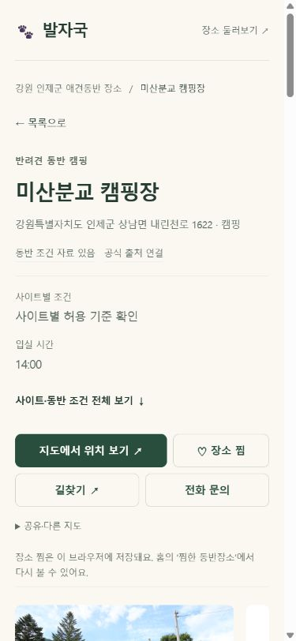
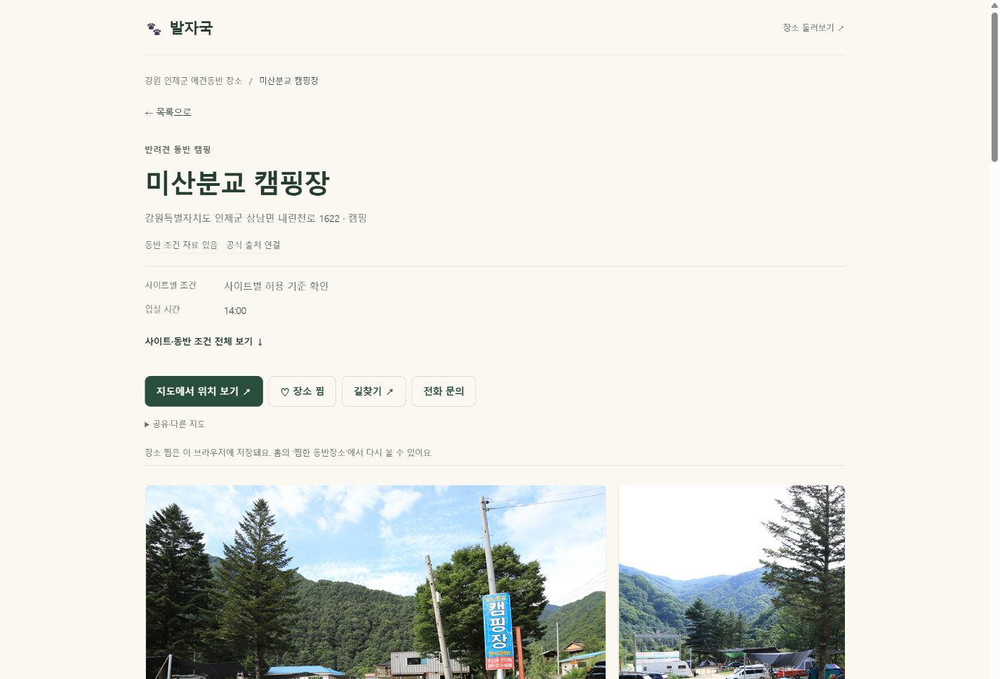

# 9차 사용자 경험·정보 신뢰성·성능 개선 — 완료

구현2026-10-26~27 / 운영 최종 확인2026-10-27. 기준 ca9caa5cd2. A59dc4a38c5, Bb41871fc28, Cf7968055ab. 중간 자동 날씨 f95de11fc5 보존.

## 실제 변경과 유지한 부분
- 홈 배경·강아지·레이아웃·사진 카드, 로그인·지도/GPS·찜·관리자·제휴 기능 유지. 데이터/권리/SEO의 임의 수정 없음.
- 광교 공원 자체 메뉴 문구는0건이었다. 하단 카페 추천의 정당한 표현은 유지하고 지도 사진 안내에 실제 업종을 전달. 사실이 아닌 오류라고 보고하지 않았다.
- 정보 상태 배지: 확인 자료·일부 미확인·공식 출처 연결·확인일 미상·180일 경과·과거 참고자료·출처 충돌을 구분. 자료 조회를 현장 검증으로 표현하지 않음.
- 사진 실패 시 같은 장소 제목·출처·프레임을 유지하는 중립 대체 문구. 다른 장소/AI 사진·재요청 없음. 사진 이용 조건/원본 비율 규칙 보존.

## 첫 검색 — 입증한 효과와 제한
전체4,619개 원본과 원래 순서/모든 필드 보존. 해시 파일7개에서 선택한 범주만 다운로드하며 재사용·공유 요청·미수신 부분 결합 지원. 처음부터 전국 전체 검색은 기존 전체 파일1개를 사용한다.

Windows Chromium390px, 검색 JSON만 gzip·150ms지연·128,000B/s로 모사. 각3회 중앙값. DOM에 첫 결과가 삽입되는 시간이며 실제 휴대폰/중급 CPU/화면 paint 측정이 아니다.

|첫 결과|8차|9차|
|---|---:|---:|
|캠핑|3,311ms|883ms|
|숙소|3,293ms|467ms|
|식당·카페|3,302ms|1,177ms|

다운로드/JSON 파싱/렌더 분리 수치는 [performance-summary.json](performance-summary.json), 표본은 [slow-network-performance.json](slow-network-performance.json). 전국 범주 없는 검색의 속도 향상은 주장하지 않음. 문자열 사전 압축 후보는 파싱6.4→7.8ms 악화로 폐기.

## 방문자 측정 보완
- 실제 place-search/care-form/map-search-form의 신뢰된 제출 이벤트 계수. 검색어 원문은 수집하지 않음. 합성 이벤트·운영자/테스트 제외 보존.
- 동일 시그니처의 서버 봇 분류 함수에 curl/Python/Go 등 프로그램 UA 추가. 기존 일반 Chrome/iPhoneSafari/GalaxyChrome·Yeti 분류, 기존 실행 권한 보존. 기존 과거 집계1,799건이 변하지 않는 것 확인. 원본 기록 소급 재분류 없음.
- 전문업소 정적 목록184페이지에서 집계 연결 누락을 발견·수정. 공통 게시 단계 및 상위 생성기가 SDK/집계를 의존 순서에 따라1회만 연결. 전체 목록1,114페이지 단일 연결 검사 통과. 정적 내용과 사진·SEO 정보 유지.
- browser는 사람 인증이 아니다. UA 위장·JS 차단·저장소 삭제·기기 중복 영향이 있어 실제 사람 수/오탐·미탐률을100% 확정하지 않는다. 새 개인 정보 항목·원시IP 수집·DB 권한 변경 없음.

## 캐시와 운영 이용 흐름
- 불변 해시 JSON, 이전8차 HTML용 고정 JSON 보존, v1/v2호환 로더. 일반 탐색HTML no-cache 재검증·공개 페이지 worker 갱신(updateViaCache:none), GPS 실행 화면 강제 reload 없음. 검색 JSON을 전체 선캐시하지 않음.
- 강제 캐시 삭제 없이 일반 reload에서 manifest2/quality9-search 및 식당카페1,713결과 유지. 운영 숙소489·캠핑1,064결과 확인. [production-cache.json](production-cache.json).
- 구버전/신버전 혼합·오프라인·시간 제한/재시도·중복 요청·늦은 응답·초기화는 자동검사. 모든 과거 HTTP/SW 캐시를 실제 휴대폰에서 재현했다고 주장하지 않음.
- 검색 목록→가야산오토캠핑장 상세→방문 준비→목록: 캠핑·이름순·40개·스크롤6828px 복원. 전화/길찾기는 정확한 href 확인, 발신·외부 앱 실행은 미검증. [production-flow.json](production-flow.json).

## 전체 적용 및 검증 범위
- 전체 생성23,441페이지, 상세22,317·목록1,114·추천 상세4,574·카드58,414의 기존 템플릿 체계 유지. 템플릿 전수 자동 검사와 실제 브라우저 표본은 다르다.
- 최종301/301 통과(추적300·기존 미추적offline-shell1). [tests-final.txt](tests-final.txt), [build-final.txt](build-final.txt).
- 원문107,561항목·사진 참조5,639·상세 메타/JSON-LD·URL·홈 구조 보존 대조 오류0. [source-preservation.json](source-preservation.json)의collections1,095는 원문 비교 대상 수이며 템플릿 전체 목록1,114와 범위가 다름.
- 로컬12대표×7폭(360/375/390/430/768/1024/1440)=84, 운영12대표×390/1440=24검사. 가로 넘침·짧은 주요CTA0. [preview-final.json](preview-final.json), [production.json](production.json), C 최종 [production-final.json](production-final.json), [catalogue-production.json](catalogue-production.json).
- 물리 iPhone/Galaxy·중급 사양CPU·실제 GPS·전화 발신·네이티브 공유·물리 스와이프/텍스트 확대 미검증. 회원 서버 동기화와 모든 앱 전환을 직접 검증했다고 하지 않음.

## 배포
A/B/C main push 완료. B Application40331986850/SEO40331986873/Pages40331983247/검색알림40332528277 success. C Application40359743348/SEO40359743420/Pages40359742370/검색알림40359743260는 [ci-final.json](ci-final.json)의 실제 결과를 따른다. 완료 후 로컬 검증 서버 종료·기존 미추적 파일 보존.

## 전후 및 운영 화면

