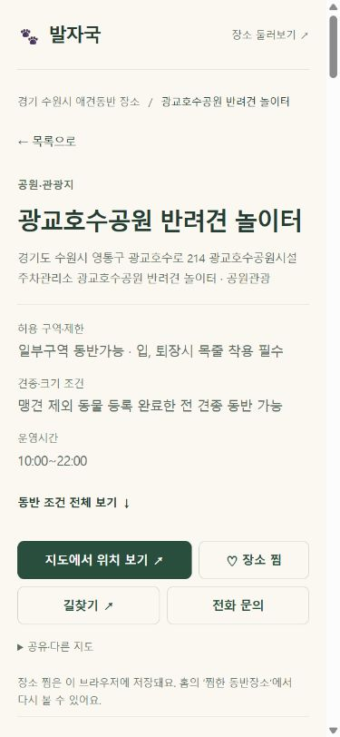
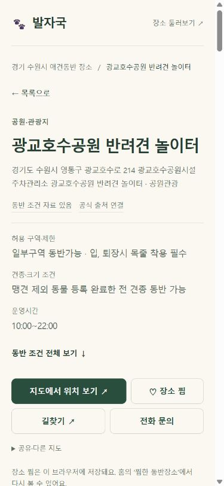
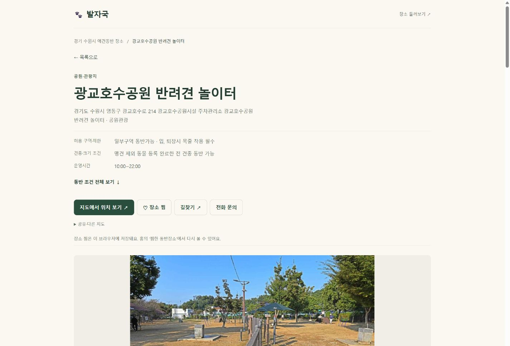

# 9차 개선 — A 검증 완료, B·C 진행 중

기준 main ca9caa5cd2. 2026-10-26.

## A 실제 발견·개선
- 광교 공원 자체 메뉴 사진 표현은 0건. 하단의 카페 추천 카드에 있는 표현은 해당 카페 설명이므로 보존. 지도 팝업의 공통 사진 문구에는 장소 유형을 전달하도록 수정.
- 원문·권리 보존 하에 정보 상태를 작은 텍스트 배지로 표시. 동반 자료와 일부 미확인, 공식 출처 연결, 확인일 미상/180일 경과/과거 참고자료를 구분. 현장 검증 완료라고 하지 않는다.
- 원본 및 카드 사진 연결 실패 시 같은 장소의 안내와 출처를 유지하며 중립 문구로 대체. 다른 장소 사진·AI 사진·재요청 없음.
- 검색 파일의 고정 경로는 8차 HTML 호환용으로 보존하고 새 HTML에는 내용 해시가 붙은 불변 파일 사용. SW는 일반 탐색에서 HTML을 no-cache 재검증, 공개 하위 페이지에서도 updateViaCache:none으로 worker 갱신 확인. 실행 중 GPS 화면 자동 재시작 없음.
- 로컬 전체 296/296(기존 미추적 offline-shell 1 포함). 대표 12화면×5폭=60 가로 넘침 0. 제어된 사진 실패에서 원래 제목·출처 링크 유지 확인.
- 이전 배포 대비 상세 22,317 원문 107,561항목·사진 참조 5,639개 누락 0. 상세 메타·JSON-LD·URL·홈 구조 보존.

## 다음 B
범주별 선택 다운로드와 기존 데이터 재사용을 구현해 다운로드/파싱/렌더링을 분리 측정. 4,619개 결과·필터·정렬 일치 유지. 느려진 반복 문자열 압축 후보는 폐기했다(파싱 6.4→7.8ms).

## 다음 C
전체 생성·자동 검사, 모바일 화면 폭·저속 검색 데이터 전송 모사, 일반 방문·오프라인·버전 혼합·목록 복귀, 운영 배포 확인. 실제 iPhone/Galaxy 및 중급 기기 하드웨어는 미보유이므로 실제 기기 검증이라고 보고하지 않는다.

